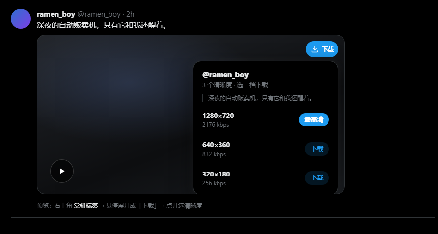
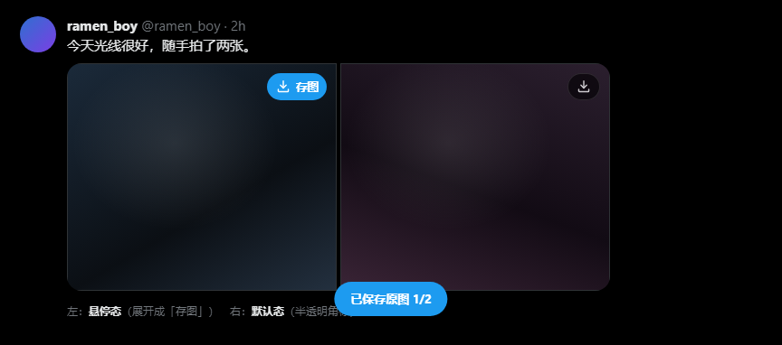
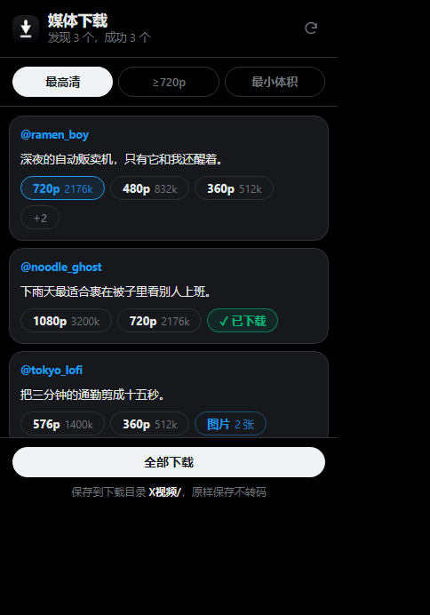
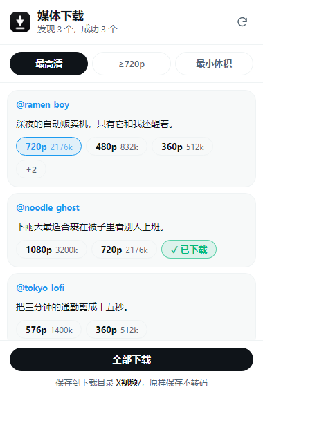

[README.md](https://github.com/user-attachments/files/34181870/README.md)
<div align="center">


# X 媒体下载器

**在 X（Twitter）一键下载视频与图片的最高清版本 —— 原样保存，不二次转码。**

[](https://developer.chrome.com/docs/extensions/develop/migrate)
[](#版本记录)
[](LICENSE)
[](#安装)
[](#安装)

</div>

---

## 它解决什么问题

X 的视频没有下载按钮。网页上右键「视频另存为」，拿到的往往是最低的 **360p**；
各种在线下载站会再把文件转码一次，画质更糊；想存张原图，还得手动改网址。

这个扩展在每条视频和图片的右上角放一个小角标，鼠标移上去就展开成下载按钮：



点开列出 X 服务器上的**全部清晰度**（带码率），选哪档下哪档 —— 而且是把那个直链**原样交给浏览器**，
中间不经过任何编码器，落盘文件与 X 服务器上的字节一致。

---

## 功能

| | |
|---|---|
| 🎬 **多清晰度视频** | 列出全部 variant（720p / 480p / 360p，含码率），任选一档 |
| 🖼 **原图保存** | 自动把缩略图地址改写为 `name=orig`，拿服务器上最大那份 |
| 📚 **多图批量** | 一条推文里的图片一次下完，带 `1/3` 进度提示 |
| 🖱 **三种入口** | 媒体角标 / 右键菜单 / 工具栏弹窗批量 |
| ⚡ **滚动零延迟** | 角标挂在媒体容器内，由浏览器原生滚动合成，不靠 JS 追位置 |
| 🎨 **跟随 X 设计语言** | 黑底 + `#1d9bf0` + 胶囊按钮，自适应浅色/深色 |
| 🔒 **最小权限** | 不要媒体域名权限、不读 cookie、不收集数据 |

<p align="center">
  
  
</p>

---

## 安装

### 方式一：加载解压缩（推荐，可随时改代码）

```bash
git clone https://github.com/<your-name>/X-DOWNLOAD.git
```

1. 打开 `edge://extensions/`（Chrome 用 `chrome://extensions/`）
2. 打开 **开发人员模式**
3. 点 **加载解压缩的扩展**，选择仓库根目录（含 `manifest.json` 的那一层）
4. **刷新已打开的 X 页面** —— 扩展装上后必须刷新一次，否则页面里没有注入脚本

> 更新代码后同理：在扩展页点刷新，再按一次 X 页面的 F5。

### 方式二：打包 `.zip`

```bash
python tools/build_zip.py
```

会在上级目录生成 `X媒体下载器.zip`。这个 zip 是**整个仓库的镜像**（含 `docs/`），
既可以解压后加载，也可以直接当仓库源 push。

---

## 使用

### 1. 媒体角标

| 媒体 | 操作 |
|---|---|
| **视频** | 鼠标移到右上角角标 → 展开「⬇ 下载」→ 点开选清晰度 |
| **图片** | 鼠标移到角标 → 展开「⬇ 存图」→ 点一下直接存原图 |

角标平时是半透明的，不挡画面；宽度小于 220px 的图（头像、表情）不会挂角标。

### 2. 右键菜单

- 视频上右键 →「下载此视频/动图（最高清）」
- 图片上右键 →「下载该图片（原图）」
- 推文链接上右键 →「下载这条推文的视频」

信息流里也能用：扩展会记住鼠标最后停在哪条媒体上。

### 3. 工具栏弹窗

点扩展图标 → 扫描当前页所有媒体 → 视频按清晰度列、图片按「n 张」打包，或一键全下。

<p align="center">
  
  
</p>

默认清晰度可切换：**最高清 / ≥720p / 最小体积**，选择会记住。

### 下载位置

```
下载目录/
├── X视频/   作者_推文ID_720p.mp4
└── X图片/   作者_推文ID_序号.jpg
```

---

## 工作原理

X 为每条视频保存了多个 variant，每个都是一个独立 mp4 直链，自带 `bitrate` 与分辨率：

```json
[
  { "url": ".../1280x720/xxx.mp4", "bitrate": 2176000 },
  { "url": ".../640x360/xxx.mp4",  "bitrate": 832000  },
  { "url": ".../320x180/xxx.mp4",  "bitrate": 256000  }
]
```

扩展做的事只有三步：

1. 从推文 ID 取回全部 variant（主用 `api.fxtwitter.com`，失败回退 X 自家的 `cdn.syndication.twimg.com`）
2. 按码率排序，取用户要的那一档
3. 把那个**直链原样交给 `chrome.downloads`**

**全程没有编码器参与**，所以下载文件 = X 服务器上那份文件。

图片同理，只是把 `?format=jpg&name=small` 改写为 `?format=jpg&name=orig`。

> 注意：X 在**上传时**就已经转过码，服务器上最高一般只到 720p/1080p。
> 本扩展保证「不再压第二次」，但不可能给你比 X 提供的更高画质。

---

## 权限说明

| 权限 | 用途 |
|---|---|
| `downloads` | 唯一的必需权限：保存文件 |
| `contextMenus` | 视频/图片的右键下载项 |
| `storage` | 记住默认清晰度（仅本地，一个字符串） |
| `scripting` | 扩展更新后给已打开的标签页补注入脚本，免得用户手动 F5 |
| `activeTab` | 仅在点击图标时判断当前标签是否为 X |
| `x.com` / `twitter.com` | 挂载角标、读取推文结构与媒体地址 |
| `api.fxtwitter.com` / `cdn.syndication.twimg.com` | 用推文 ID 查询清晰度直链（只读公开接口，无登录、无 cookie） |

媒体文件（`video.twimg.com` / `pbs.twimg.com`）经浏览器下载接口直接保存，**不需要**额外域名权限，
所以权限清单刻意保持最小。

---

## 常见问题

<details>
<summary><b>为什么下载到的还是 360p？</b></summary>

因为选的是最低档。点角标会列出全部档位，标着「最高清」的那行才是码率最高的。
如果最高只有 360p，说明作者上传的就是 360p —— X 只在有更高源文件时才保留更高 variant。
</details>

<details>
<summary><b>「无损」到底能到多高？</b></summary>

受限于 X。X 上传即转码，普通账号一般最高 720p，部分可达 1080p。
扩展只能保证「不再压」，拿不到比 X 服务器更高的版本。
</details>

<details>
<summary><b>动图下载为什么是 mp4？</b></summary>

X 早就不存 `.gif` 了，所有动图都被转成无声 mp4。你下到的 mp4 就是原件，不存在更高清的「gif」。
</details>

<details>
<summary><b>角标不出现 / 弹窗说需要刷新？</b></summary>

扩展安装或更新后，**已经打开的标签页**里还是旧脚本。
打开弹窗会自动补注入；补不上就按一次 `F5`。之后不会再出现。
</details>

<details>
<summary><b>私密账号的推文能下吗？</b></summary>

不能。解析走的是只读公开接口，拿不到受保护内容。这也不在扩展的设计目标里。
</details>

<details>
<summary><b>会不会偷偷上传我的数据？</b></summary>

不会。没有统计、没有远程配置、不读 cookie、不碰私信。
唯一的网络请求是把**推文 ID** 发给解析接口换取直链。
</details>

<details>
<summary><b>README 里的图片显示不出来？</b></summary>

`docs/` 目录没有一起提交。图片用的是相对路径，必须把整个 `docs/` 文件夹放进仓库根目录。
</details>

---

## 目录结构

```
x-media-downloader/
├── manifest.json          # MV3 清单
├── background.js          # 解析 variant / 选清晰度 / 调下载 / 右键菜单
├── content.js             # 角标注入、清晰度面板、页面扫描
├── content.css            # 页面内 UI（X 设计 token，含深浅色）
├── popup.html/js/css      # 工具栏弹窗
├── icon16/32/48/128.png   # 扩展图标（小尺寸做了光学校正）
├── docs/                  # README 用图
└── tools/
    ├── make_icons.py      # 生成四个尺寸的图标
    ├── make_store_assets.py
    └── build_zip.py
```

---

## 开发

```bash
# 语法检查（需要 Node）
node --check background.js && node --check content.js && node --check popup.js

# 重新生成图标（需要 Pillow）
python tools/make_icons.py

# 打包
python tools/build_zip.py
```

`tools/build_zip.py` 会顺带做一次校验：解压到临时目录，按 `manifest.json` 逐项确认引用文件存在、
逐张 `verify()` 图标 PNG —— 因为「图标路径写错导致扩展加载失败」正是本项目踩过的坑。

---

## 已知限制

- 每条推文目前只处理**第一个**视频
- 宽度小于 220px 的图片不挂角标
- 需要联网解析（直链下载本身走 CDN）
- 不做批量爬取、不绕过付费墙

---

## 版本记录

### 1.1.0
- 新增图片下载：原图直出、多图批量、图片右键菜单
- 修复滚动时角标跟不上 —— 改为挂载在媒体容器内，原生滚动合成，零 JS 参与
- 删除滚动重排与定时器，降低页面 CPU 占用
- 权限收敛：移除不必要的媒体域名权限

### 1.0.0
- 首发：多清晰度视频下载、右键菜单、弹窗批量、深浅色主题

---

## 免责声明

本项目仅供**个人备份**与学习用途。请遵守 X 的服务条款与所在地区的版权法规，
不要用于二次分发他人作品。所有内容版权归原作者所有。

## License

[MIT](LICENSE)
